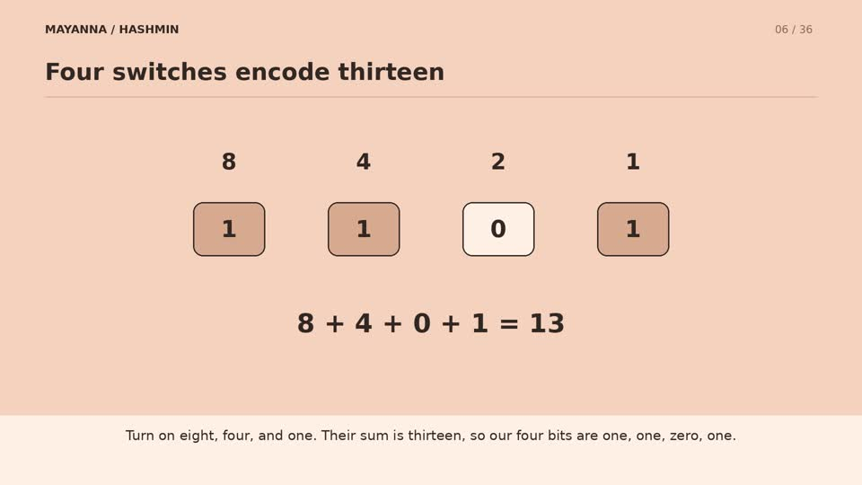

# Mayanna–HashMin Verify Protocol

**Proving a credential claim without revealing the underlying value.**

### [Watch the animated explainer (6:07 · Full HD)](docs/Mayanna-HashMin-Explainer-1080p.mp4)

[](docs/Mayanna-HashMin-Explainer-1080p.mp4)

A step-by-step, narrated walkthrough of the four-bit example, issuer signatures, secret sharing and MPC-in-the-head verification.

[Download the video](https://github.com/mayank-muthanna/Mayanna-Hashmin-Verify-Protocol/raw/refs/heads/master/docs/Mayanna-HashMin-Explainer-1080p.mp4)

### [Read the research paper (PDF)](docs/Mayanna-HashMin-Primitives.pdf)

[Download the PDF](https://github.com/mayank-muthanna/Mayanna-Hashmin-Verify-Protocol/raw/refs/heads/master/docs/Mayanna-HashMin-Primitives.pdf) · [MIT licence](LICENSE) · [Contributing](CONTRIBUTING.md) · [Security](SECURITY.md)

**Global Research Challenge 2026 — Semi-Finalist.** [View the competition results](https://www.globalresearchchallenge.org/2026-results/).

Created by **Mayank Muthanna**.

## The idea

A service checking whether someone is over 18 needs the answer to `age >= 18`, rather than an identity document or exact date of birth. The same idea applies to score thresholds, membership levels and eligibility checks.

Mayanna–HashMin explores predicates over small, issuer-authenticated credential attributes using salted hash commitments, Merkle trees, digital signatures and MPC-in-the-head. The goal is a readable construction whose proved relationship is explicit: the hidden value must open the issuer-authenticated commitments **and** satisfy the public predicate.

This repository contains the research paper and an experimental Go implementation. The paper describes the intended construction; the current code implements only parts of it.

## Research paper

**Mayanna–HashMin Primitives: Simple Hash-Based Zero-Knowledge Predicate Proofs for Small Credential Claims**  
Mayank Muthanna · 20 July 2026

The [full paper](docs/Mayanna-HashMin-Primitives.pdf) covers the construction, security arguments, privacy and leakage, efficiency, limitations and future work. Click the link to open GitHub's PDF viewer.

## How the proposed construction works

There are three real actors: an **issuer**, a **holder** and a **verifier**. The three virtual MPC parties are simulated locally by the holder; they are not three external servers.

1. **Issue a credential.** The issuer encodes an attribute as bits, commits to each bit with fresh randomness, builds a Merkle tree and signs the root together with the schema and bit length.
2. **Define the claim.** The verifier supplies a public predicate, such as `x >= 18`.
3. **Evaluate privately.** A Boolean circuit checks both the commitment openings and the predicate. The holder evaluates it through three simulated MPC parties using secret shares of the witness.
4. **Commit and challenge.** The holder commits to all simulated views. A challenge selects two views to open in each repetition. The paper's non-interactive construction derives challenges together using Fiat–Shamir after all commitments are fixed.
5. **Verify.** The verifier checks issuer authentication, the credential root, the required view openings, gate transitions, cross-view consistency and an output that reconstructs to `1`.

For example, a holder with `x = 13` can prove `x >= 8` without disclosing the value, the credential bits or the decisive comparison position, under the assumptions described in the paper.

The construction builds on existing work, particularly IKOS and ZKBoo. It does not claim to invent MPC-in-the-head or replace optimised general-purpose zero-knowledge systems.

## Implementation status

**Research prototype; incomplete and not independently audited.** The paper's security arguments must not be read as guarantees about this implementation.

| Area | Current repository |
| --- | --- |
| Credential primitives | Value encoding, salted commitments, Merkle roots, schemas and wallet construction in `pkg/hm` |
| Policies | Predicate structures and preliminary policy classification; no complete predicate-to-proof compiler |
| MPC primitives | XOR sharing, Boolean gates, simulated views, view commitments and experimental proof generation/verification in `pkg/mpc` |
| Examples | A value-encoding command and a credential-construction example |
| Complete protocol | Issuer signatures and the full issuer–holder–verifier flow remain to be integrated |

The current proof code derives challenges separately per round and sets `Repetitions = 80`; this differs from the paper's combined Fiat–Shamir transcript. Eighty repetitions do **not** mean 80-bit soundness: the paper's basic bound is `(2/3)^s`, with 137 repetitions for roughly 80 bits and 219 for roughly 128 bits. The current verifier also lacks the paper's complete AND-gate/cross-view consistency and accepting-output checks. These are implementation gaps to resolve before making security claims.

## Getting started

The module declares **Go 1.22.2**. Install Go 1.22.2 or later.

```sh
git clone https://github.com/mayank-muthanna/Mayanna-Hashmin-Verify-Protocol.git
cd Mayanna-Hashmin-Verify-Protocol
go test ./...
go run ./cmd/hashmin
go run ./examples
```

`cmd/hashmin` encodes the integer `18` and prints its type and bits. `examples` constructs a sample credential and prints its root, field names and number of stored openings. These demonstrate primitives, rather than an end-to-end age-verification proof. The example's identity-schema names are illustrative and imply no affiliation with an identity authority.

## Repository guide

| Path | Purpose |
| --- | --- |
| [`docs/Mayanna-HashMin-Primitives.pdf`](docs/Mayanna-HashMin-Primitives.pdf) | Research paper |
| [`cmd/hashmin/`](cmd/hashmin/) | Encoding demonstration |
| [`examples/`](examples/) | Credential-construction example |
| [`pkg/hm/`](pkg/hm/) | Credential, commitment, encoding, Merkle and policy primitives |
| [`pkg/mpc/`](pkg/mpc/) | Experimental MPC-in-the-head components |
| [`CITATION.cff`](CITATION.cff) | Citation metadata |

## Privacy and limitations

The proposed proof hides the witness, but the public statement still exposes the issuer key, credential root, commitments, schema, bit length, predicate and proof parameters. Reusing a credential root can link presentations. Multiple predicates can narrow the hidden value by logical inference.

Proofs are not succinct, and commitment hash circuits can dominate computation. Revocation, expiry, replay protection, unlinkable presentations and side-channel protection require additional work. Fresh randomness, canonical serialization and strict domain separation are essential. See the paper for the assumptions and scope of its security arguments.

## Roadmap

- Complete deterministic predicate and commitment-opening circuits.
- Integrate issuer signatures and the full credential presentation flow.
- Align proof generation and verification with the paper's transcript and consistency checks.
- Add adversarial tests, proof-size measurements and performance benchmarks.
- Explore compressed views, improved commitment layouts and a small predicate language.
- Develop replay protection, revocation, expiry and unlinkable presentations.
- Seek independent cryptographic review.

## Contributing and reporting issues

Research feedback, implementation improvements and reproducible bug reports are welcome. Read [CONTRIBUTING.md](CONTRIBUTING.md) and the [Code of Conduct](CODE_OF_CONDUCT.md) before participating. For security-sensitive findings, follow [SECURITY.md](SECURITY.md).

## Citation and prior work

If you build on this project, cite the paper using [CITATION.cff](CITATION.cff). The paper's references include Ishai, Kushilevitz, Ostrovsky and Sahai (IKOS); Giacomelli, Madsen and Orlandi (ZKBoo); Fiat and Shamir; Merkle; HashWires; Bulletproofs; and Groth's pairing-based arguments. Consult the PDF for full bibliographic details.

## Licence

Copyright © 2026 Mayank Muthanna. The original code and documentation, including the accompanying paper, are available under the [MIT License](LICENSE). Referenced third-party works retain their respective rights. Attribution through citation is appreciated.
